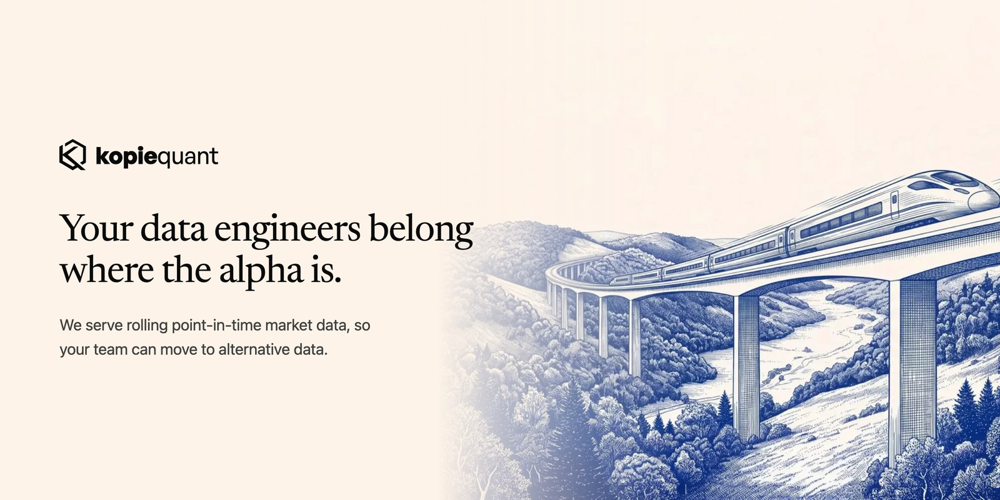

## About Kopie Quant

Kopie Quant runs the market data layer for quant funds, so their data engineers can move to the work where the alpha is: alternative data.

Citadel, Jane Street and Hudson River Trading research at full speed because they built their own data platforms and staff whole teams to keep them running. Most funds under $5 billion have neither the engineers nor the time to do the same. Their data runs on bespoke, vendor-specific pipelines: point-to-point scripts that each serve one feed, break when a vendor changes a format, and turn every new dataset into an integration project of six to ten months. Kopie Quant gives these funds the platform the largest firms built for themselves.

We onboard a new feed in about 30 minutes, then clean, adjust and normalize it into rolling point-in-time and point-in-time data, so a walk-forward test sees each trading day only as it stood on that date. Researchers pull their own data in seconds, and it stays in the fund's own cloud account, under the fund's own keys.

[kopiequant.com](https://kopiequant.com)
